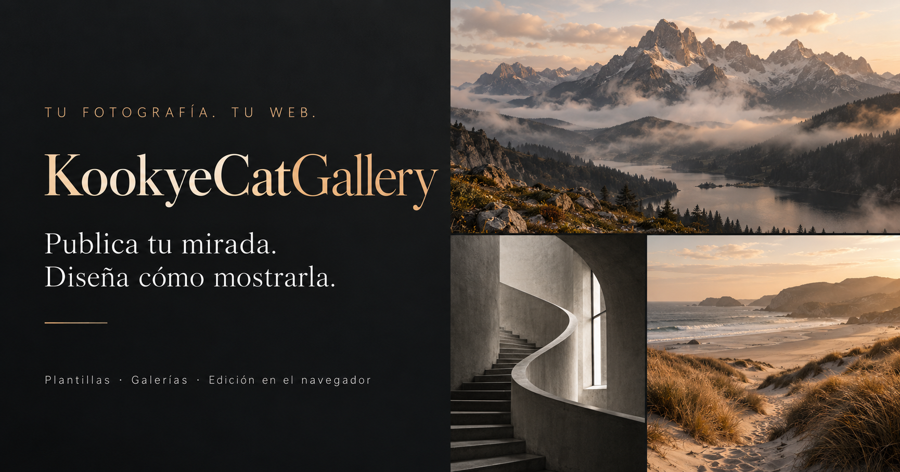

<p align="center">
  
</p>

<h1 align="center">KookyeCatGallery</h1>

<p align="center">
  <strong>Tu fotografía. Tu web.</strong><br>
  Una galería fotográfica autoalojada, personalizable y gestionada desde el navegador.
</p>

<p align="center">
  <a href="LICENSE"></a>
  <a href="#requisitos"></a>
  <a href="app-manifest.php"></a>
  <a href="#opciones-de-galería"></a>
</p>

<p align="center">
  <a href="docs/tipografias.md"></a>
  <a href="#microblog"></a>
  <a href="#ia-opcional"></a>
  <a href="#actualizar-una-instalación"></a>
</p>

<p align="center">
  
  
  
  <a href=".github/workflows/validate.yml"></a>
</p>

<p align="center">
  <a href="#instalación-y-uso">Instalación</a> ·
  <a href="#desplegar-en-el-hosting">Despliegue</a> ·
  <a href="#actualizar-una-instalación">Actualizaciones</a> ·
  <a href="docs/subida-fotografias.md">Subir fotografías</a> ·
  <a href="docs/opciones-galeria.md">Opciones de galería</a> ·
  <a href="#guías">Guías</a>
</p>

---

KookyeCatGallery es una web de fotografía que se instala en tu propio alojamiento. No necesita un servidor de base de datos, servicios externos ni un proceso de compilación (el microblog usa un archivo SQLite incluido en PHP). Después de instalarla, puedes gestionar las fotografías, el diseño y el contenido desde un panel privado.

## Funciones principales

- **Gestión de fotografías desde el navegador:** biblioteca visual con búsqueda y filtro por categoría, edición rápida de datos, editor fotográfico, favoritos, borradores y orden personalizado.
- **Carga por lotes:** selecciona varias fotografías y asígnales una categoría existente o crea una nueva para todo el lote.
- **Categorías:** crea, renombra, combina, mueve o elimina categorías. En la web se pueden mostrar como enlaces para filtrar las fotografías de cada colección.
- **Edición visual del sitio:** tras iniciar sesión, activa «Editar página» para cambiar textos en su contexto directamente en la web. Las redes sociales y las páginas legales se administran en sus apartados del panel.
- **Diseño adaptable:** cabeceras, paletas, organización de bloques y diseños independientes para móvil y escritorio.
- **Tipografías locales:** 30 parejas de fuentes para títulos y texto, con ejemplos reales en el panel. Los archivos y sus licencias se distribuyen con la web.
- **18 composiciones de galería:** diez diseños estándar y ocho premium. Los controles que no corresponden a un diseño se desactivan; la misma regla se aplica al guardar en el servidor.
- **Efectos hover accesibles:** diez efectos compartidos por los diseños, también disponibles al enfocar con teclado y respetando la preferencia de movimiento reducido.
- **Identidad visual con recortador:** sube la foto de perfil, el logo, el icono de la app (también usado como favicon) y la imagen para compartir en redes. Si una imagen no tiene la proporción de su hueco, un recortador integrado te deja encuadrarla antes de enviarla. Cada campo indica su proporción. El icono se adapta automáticamente a los tamaños necesarios y el logo aparece también en la marca del panel.
- **Un solo nombre de web:** el nombre se escribe en un único campo (**Ajustes → Textos**, o con «Editar página») y es a la vez el título grande de la portada, el crédito del pie y el nombre del panel.
- **Microblog opcional:** feed estilo Tumblr / Threads con texto y enlaces (`[texto](url)`), citas, imágenes en WebP, tres niveles de destacado, post fijado, publicación programada, hilos de respuestas del propietario, corazones y código para incrustar cada post. Se crea desde el panel o desde un panel flotante en la propia web, abierto con el botón «+». Está desactivado inicialmente. [Ver la sección](#microblog).
- **Mapa opcional:** representa las fotografías con coordenadas y permite abrir sus fichas. Está desactivado inicialmente.
- **Aplicación instalable (PWA):** experiencia adaptable e instalación desde navegadores compatibles.
- **Asistencia de escritura con IA opcional:** pestaña **Inteligencia artificial** en el panel para activarla o desactivarla, guardar las claves de Gemini y OpenRouter y definir el estilo de los textos que se generan. Viene desactivada y sin claves en el repositorio.
- **Instalador y actualizaciones:** `install.php` deja la web lista (acceso, ajustes, carpetas y microblog) y `scripts/update.php` actualiza el núcleo con copia previa y vuelta atrás, sin tocar tus fotos ni tus datos.
- **Cámara en el móvil:** «Usar cámara» en todos los campos de fotografías (subida, lotes, microblog, perfil), en Android e iPhone.
- **Fotos fijadas y destacadas:** las fijadas van arriba de la galería con un marco muy fino y las destacadas llevan un distintivo de esquina, ambos con los colores de la paleta elegida.
- **Insignia de verificación a tu gusto:** mostrarla u ocultarla y elegir entre 13 insignias; el logo siempre redondo y sin tapar la foto de perfil, y el mapa con los colores de la paleta.
- **Editor de páginas con Quill:** formato con botones que aplican, alternan y marcan su estado, también en pantallas táctiles.
- **Imágenes ligeras:** fotos de galería y de microblog en WebP al 80 % con el lado mayor en 1800 px, generadas al publicar.
- **Fotografías por el panel o por FTP:** súbelas desde el navegador o deja JPG y PNG en `img/`; la web los procesa sola en la siguiente visita.

## Instalación y uso

### Requisitos

- Hosting con **PHP 8.1 o posterior**.
- Extensiones PHP **GD** con JPEG, PNG y WebP, **Fileinfo** y **pdo_sqlite** (para el microblog; sin ella funciona con un archivo JSON).
- HTTPS y permisos de escritura para PHP en las carpetas de datos y cargas.
- Apache con soporte para `.htaccess`, o Nginx configurado por el proveedor para las rutas de la aplicación y el bloqueo de carpetas privadas.

No funciona en alojamiento exclusivamente estático. No necesita MySQL, Composer, npm ni Node.js para servir la web. Node.js y Playwright solo se usan para desarrollo y comprobaciones automatizadas.

### Desplegar en el hosting

El repositorio contiene también pruebas, documentación y herramientas de mantenimiento que **no deben subirse al hosting**. Hay dos formas de llevar solo lo necesario:

**A. Paquete de producción (recomendada).** Necesita PHP en tu ordenador solo para generarlo:

```sh
git clone https://github.com/DavidJLlanes/KookyeCatGallery.git
cd KookyeCatGallery
php scripts/export-core.php ../kcg-hosting --produccion
```

La carpeta `kcg-hosting/` es lo que se sube: la web sin `tests/`, `docs/`, `.github/` ni herramientas de desarrollo, con las carpetas de datos vacías y protegidas, `install.php` y `scripts/update.php` para actualizar más adelante.

**B. Copia manual.** Descarga el repositorio (o el ZIP de GitHub) y sube todo **menos** `tests/`, `docs/`, `.github/`, `scripts/defaults/`, `scripts/export-core.php`, `scripts/build-catalogs.php`, `scripts/core-files.json` y `pendiente.md`. Conserva los archivos ocultos, en especial `.htaccess`.

#### Elige cómo instalar

| Tu servidor | Cómo se instala | Qué tienes que hacer |
| --- | --- | --- |
| **Hosting compartido** (cPanel, Plesk, IONOS, Hostinger…) | Instalador web `install.php` | Subir los archivos y abrir `install.php` en el navegador |
| **VPS o servidor dedicado** (Linux con acceso SSH y `sudo`) | Instalador `instalar.sh` | Subir los archivos y ejecutar **una** orden por SSH |

Los dos usan la misma lógica (`core/Installer.php`): comprueban el servidor, te explican con su solución lo que falte, crean el administrador y dejan la web lista. El motivo de que haya dos es que un script PHP que corre dentro del servidor web no puede darse a sí mismo permisos de escritura: en un hosting compartido el servidor ya se los da (PHP corre con tu usuario), pero en un VPS hay que asignarlos una vez con `sudo`, y eso lo hace `instalar.sh`.

#### A. Hosting compartido (instalador web)

1. Añade el dominio o subdominio en el panel del hosting y **activa HTTPS**. Comprueba que usa **PHP 8.1+** con GD (JPEG, PNG y WebP), Fileinfo y pdo_sqlite.
2. Sube el contenido del paquete a la raíz pública del sitio, normalmente `public_html` (por FTP, SFTP o el gestor de archivos). Incluye `.htaccess`: algunos programas FTP ocultan los archivos que empiezan por punto.
3. Abre `https://tu-dominio/install.php`. Verás la **comprobación del servidor** (✔ bien, ! aviso, ✖ impide instalar), cada punto con su explicación y cómo arreglarlo. Si todo está bien, indica la URL HTTPS del sitio, un usuario y una contraseña única de al menos 12 caracteres. El instalador deja la web lista: guarda el acceso y la URL, crea los ajustes iniciales, las carpetas de fotos y la base del microblog, y te dice qué ha preparado y qué conviene revisar. Si ya hay un administrador registrado, no deja registrar otro.
4. Si la comprobación marca carpetas sin permiso de escritura, pon permisos 755 (o 775) a `data/`, `img/`, `imagenes/`, `microblog/` y `uploads/` desde el gestor de archivos, o pide al proveedor que las asigne al usuario de PHP, y recarga la página.
5. **Borra `install.php`.** El instalador intenta borrarse solo, pero comprueba en el gestor de archivos que ha desaparecido y, si sigue ahí, bórralo: es mejor no tenerlo nunca publicado una vez instalada la web.
6. Entra en `https://tu-dominio/admin.php`, inicia sesión y personaliza la web: en **Ajustes → Contenido** sube tu foto de perfil, logo, icono e imagen para redes (el recortador te ayuda con las proporciones) y en **Ajustes → Textos** escribe el nombre de la web.
7. Sube fotografías desde **Subir foto** o deja JPG y PNG en `img/` por FTP y abre la portada.

#### B. VPS o servidor dedicado (`instalar.sh`)

Requisitos: Linux, acceso SSH con `sudo`, PHP 8.1+ (CLI y FPM) con `php-gd`, `php-sqlite3` y `php-mbstring`, y Nginx o Apache con HTTPS ya configurado para tu dominio.

1. Sube el contenido del paquete a la carpeta de la web (por ejemplo `/var/www/tu-dominio`), con `scp`, `rsync` o SFTP.
2. Entra por SSH y ejecuta, desde esa carpeta:

   ```sh
   cd /var/www/tu-dominio
   sudo sh instalar.sh tu-dominio.com
   ```

   Te pregunta el usuario administrador y la contraseña (mínimo 12 caracteres; no se ve al escribir). Puedes darle el usuario con `--admin nombre`.
3. El script hace, en orden y explicando cada paso: comprueba PHP 8.1+, **detecta el usuario con el que corre PHP** (o usa el de `--web-user`), crea las carpetas con sus permisos (`scripts/preparar-servidor.sh`), comprueba extensiones y carpetas con ese usuario, **crea el administrador y deja la web lista** (`scripts/install-cli.php`), borra `install.php` y te muestra el bloque de Nginx que necesitas.
4. Si usas Nginx, copia ese bloque en el `server` de tu dominio y recarga: `sudo nginx -t && sudo systemctl reload nginx`. Con Apache no hace falta nada más: el `.htaccess` ya protege las carpetas privadas.
5. Entra en `https://tu-dominio.com/admin.php` y sigue desde el paso 6 de la opción A.

Opciones útiles: `--web-user USUARIO` si PHP no corre como `www-data`; `--privada /ruta` para elegir la carpeta privada (por defecto `config`, junto a la carpeta de la web); `--ayuda` muestra todo. La contraseña no queda en ningún archivo ni en el historial: se pasa al instalador por la entrada estándar. Para automatizarlo: `export KCG_ADMIN_PASSWORD=...` y `sudo --preserve-env=KCG_ADMIN_PASSWORD sh instalar.sh tu-dominio.com --admin nombre`. El script se puede repetir sin riesgo: si ya hay administrador, no crea otro.

Si ya instalaste y solo necesitas arreglar permisos (por ejemplo, tras copiar archivos como `root`): `sudo sh scripts/preparar-servidor.sh`.

> **Servidor propio, copiar archivos y permisos.** Copiar los archivos con `sudo` los deja como propiedad de `root`: está bien para el código (PHP no puede modificarlo, que es más seguro), y por eso `instalar.sh` solo da permiso de escritura a PHP sobre sus siete carpetas (`img/`, `data/`, `imagenes/desktop/`, `imagenes/mobile/`, `microblog/`, `uploads/` y la carpeta privada).

El instalador prepara una carpeta privada `config/` fuera de la raíz pública cuando los permisos del hosting lo permiten. La estructura habitual queda así:

```text
cuenta/
├── public_html/   ← archivos públicos de la web
└── config/        ← ajustes y credenciales privadas
```

Si el alojamiento no permite escribir fuera de `public_html`, consulta la [guía detallada de instalación](docs/instalacion.md). Explica la ruta alternativa `var/`, la variable `GALLERY_PRIVATE_DIR`, los permisos y las diferencias entre Apache y Nginx. Que PHP funcione en Windows o Linux no garantiza que cualquier plan permita los permisos necesarios; el proveedor debe admitir los requisitos anteriores.

> **Seguridad del instalador:** `install.php` es temporal. Mientras exista y todavía no haya acceso configurado, cualquier visitante puede llegar al formulario para crear el usuario administrador. Úsalo una sola vez y comprueba que se ha borrado. Si el alojamiento no puede borrarlo automáticamente, elimínalo manualmente.

Las rutas de las fichas, como `/foto/slug`, requieren las reglas de reescritura incluidas en `.htaccess`. Si ves un 404 de LiteSpeed, verifica que el archivo se copió (algunos programas FTP ocultan los archivos que empiezan por punto) y que el proveedor permite sus reglas. En Nginx, `.htaccess` no tiene efecto: el proveedor debe configurar las rutas y denegar el acceso web a `var/`, `data/` e `img/`.

### Actualizar una instalación

El núcleo (código, estilos, scripts y archivos genéricos) se separa de lo propio de tu web: `installation.php`, las fotografías, los datos y la carpeta privada `config/`. Una actualización solo cambia el núcleo y deja una copia de seguridad para volver atrás.

1. Descarga la versión nueva (un paquete del núcleo para producción, con `core-manifest.json`; no hace falta subir `tests/` ni la documentación de desarrollo) y descomprímela en una carpeta **fuera** de la raíz pública.
2. Desde la raíz de tu web, mira qué cambiaría: `php scripts/update.php /ruta/a/la-version-nueva --plan`.
3. Aplícala: `php scripts/update.php /ruta/a/la-version-nueva`. Antes de tocar nada guarda en `config/backups/` los archivos que se van a cambiar y tus ajustes, y al terminar comprueba la sintaxis; si algo falla, se deshace sola.
4. Si algo no va bien después: `php scripts/update.php --rollback` (restaura la última copia; `--list` las enumera).
5. Si has modificado a mano archivos del núcleo, la actualización se detiene y los nombra: tus personalizaciones van en `installation.php`. Con `--overwrite-modified` se pisan (quedan en la copia).
6. **No dejes `install.php` accesible**: el paquete no lo incluye en una instalación que ya tiene acceso configurado; si lo ves en la raíz pública, bórralo. Conserva solo el archivo de ejemplo `reset-admin-access.php.example`.

Sin SSH ni PHP de línea de comandos, copia los archivos del paquete sobre los existentes (nunca sobre `installation.php`, `config/`, `var/`, `data/` ni las fotografías) y guarda antes una copia de `config/`.

### Copias de seguridad y cambio de dominio

Guarda una copia de `config/` (o `var/`, según tu instalación), de las fotografías y de cualquier archivo propio que hayas añadido. El microblog es un único archivo `microblog.sqlite` dentro de la carpeta privada. Antes de restaurar, conserva la estructura y los permisos de escritura para PHP. Si cambias de dominio, actualiza la URL pública guardada (`public-url.txt`) o establece `GALLERY_PUBLIC_URL` en la configuración del hosting. Consulta [instalación](docs/instalacion.md) para los detalles.

## Administración y personalización

El panel está en `/admin.php`. Sus áreas separan **Contenido**, **Diseño**, **Textos**, **Redes sociales** y **Publicación**, para que cada tipo de ajuste tenga un lugar claro.

- **Contenido:** sube una foto, edita una existente, utiliza la biblioteca visual o carga un lote.
- **Categorías:** administra colecciones por separado y asigna las fotos desde el editor o la carga por lotes.
- **Diseño:** elige cabeceras, galería móvil y de escritorio, paleta, efectos, estructura de la página e identidad gráfica.
- **Textos:** cambia el nombre de la web (único: portada, pie y panel), la identidad del autor, el rótulo y título de «El proyecto», textos de presentación y las páginas de texto.
- **Redes sociales:** elige los perfiles, enlaces y nombres visibles; configura también los textos de esa sección.
- **Publicación:** ajusta opciones para mostrar y compartir la web.

Al iniciar sesión, el botón redondo **Editar página** activa la edición contextual de los textos disponibles. Pulsa un texto editable, realiza el cambio y guárdalo. Esta edición no reemplaza las herramientas del panel para fotografías, redes sociales o páginas legales.

Las cuatro imágenes de identidad se suben en **Ajustes → Contenido**. Si la que eliges no tiene la proporción del hueco, se abre un recortador para encuadrarla (arrastrar y zoom) antes de enviarla:

| Imagen | Proporción | Tamaño recomendado | Dónde se usa |
| --- | --- | --- | --- |
| **Foto de perfil** | 4:5 vertical | 800 × 1000 px | Retrato de «El proyecto», cabecera y avatar del microblog |
| **Logo** | 1:1 cuadrada | 512 × 512 px | Portada, cabecera móvil y marca del panel |
| **Icono de la app** | 1:1 cuadrada | 512 × 512 px como mínimo | Favicon, Apple Touch e icono de la PWA (se generan 32, 180, 192 y 512 px) |
| **Imagen para redes (Open Graph)** | 1,91:1 apaisada | 1200 × 630 px (mínimo 600 × 315) | Vista previa al compartir en redes y mensajería |

Los formatos aceptados son JPG, PNG y WebP, con un máximo de 15 MB por imagen. Si el hosting limita el tamaño total de la subida (`post_max_size`), el panel lo explica y puedes subirlas de una en una.

### Opciones de galería

Móvil y escritorio tienen selectores independientes. Hay diez diseños estándar:

| Diseño | Composición |
| --- | --- |
| **Masonry** | Columnas que conservan las proporciones originales. |
| **Cuadrícula** | Miniaturas uniformes; admite proporciones cuadrada, 4:3 o 3:4. |
| **Mosaico cromático** | Filas de imágenes con sus proporciones originales y bordes contiguos. |
| **Editorial asimétrica** | Filas con distinta densidad de columnas. |
| **Filas por categoría** | Colecciones en tiras horizontales; muestra todas las fotos de cada fila. |
| **Álbum desordenado** | Composición de tarjetas cuadradas con tamaños y giros variados. |
| **Sala de exposición** | Fotografías grandes, centradas y espaciadas. |
| **Hoja de contactos** | Presentación compacta; permite ajustar la proporción. |
| **Secuencia narrativa** | Fotografía protagonista seguida de una secuencia. |
| **Trípticos** | Grupos de tres con composición propia. |

Los diez efectos hover son Suave, Acercamiento, Elevación, Revelado, Virado de color, Marco luminoso, Desplazamiento, Perspectiva, Enfoque y Destello.

Las ocho galerías premium sustituyen la estándar y su interfaz se ajusta al tipo de navegación:

| Galería | Presentación |
| --- | --- |
| **Baraja** | Cartas fotográficas a pantalla completa con navegación gestual. |
| **Cover Flow** | Foto central frontal y fotos vecinas giradas en perspectiva, con reflejo. |
| **Burbujas** | Fotos circulares flotantes, distribuidas por la pantalla. |
| **Cuadrados** | Composición flotante como Burbujas con tarjetas cuadradas. |
| **Tambor** | Carrusel cilíndrico 3D con las imágenes curvadas hacia los lados. |
| **Cilindro** | Varias filas de fotos dispuestas alrededor de un cilindro. |
| **Polaroids** | La foto activa destaca entre tarjetas inclinadas sobre un fondo oscuro. |
| **Tinder** | Una tarjeta cada vez, con gestos para pasar y marcar favoritos. |

Las opciones incompatibles se ocultan o desactivan con una explicación y el servidor también impide que se guarden para diseños que no las usan. Baraja, Cover Flow, Tambor, Cilindro, Polaroids y Tinder controlan su propia composición y navegación. Burbujas y Cuadrados sí utilizan «Fotos visibles a la vez» como límite de página. En los diseños compatibles, las columnas, la cantidad de fotos y la paginación se aplican según corresponda. La selección «Todas» desactiva la paginación cuando ya no se utiliza.

Consulta la [matriz completa de compatibilidad](docs/opciones-galeria.md) y la guía de [galerías premium](docs/galerias-premium.md) antes de elegir combinaciones.

## Microblog

Feed de notas cortas en la portada, con aspecto de Tumblr / Threads y una columna estrecha de unos 560 px en escritorio. Solo el propietario (el usuario del panel) publica, edita, responde y borra; cualquier visitante puede dar corazón. Está desactivado inicialmente: actívalo en **Ajustes → Publicación**.

### Qué puede llevar un post

- **Texto** de hasta 2.000 caracteres, con párrafos y saltos de línea.
- **Enlaces dentro del texto:** escribe `[texto](https://…)` para que «texto» sea el enlace, o usa el botón **Enlace** (también Ctrl+K), que lo inserta por ti usando como texto lo que tengas seleccionado. Las URLs sueltas se enlazan solas. Solo se admiten `http` y `https`; el resto del texto se escapa.
- **Una cita** con su fuente y un enlace opcional.
- **Hasta 4 enlaces** con tarjeta (título opcional).
- **Hasta 4 imágenes**, con texto alternativo opcional. Se convierten siempre a **WebP con calidad 80** y su **lado mayor se reduce a 1800 px** manteniendo la proporción (nunca se amplían las pequeñas), y se eliminan los metadatos EXIF y GPS. El navegador las reduce a la misma medida antes de enviarlas. Se guardan en `/microblog/`, separadas de la galería.

### Niveles, fijado y programación

| Opción | Efecto |
| --- | --- |
| **Normal** | Tarjeta sencilla. |
| **Destacado** | Franja lateral de color y velo del color de acento. |
| **Súper destacado** | Borde luminoso animado, brillo que barre la tarjeta y letra algo mayor. |
| **Fijar arriba** | Un post raíz se coloca el primero del feed con el distintivo «Fijado». Solo hay uno a la vez: fijar otro suelta el anterior. |
| **Programar** | Fecha y hora de publicación (la zona horaria del servidor o la de la variable `MICROBLOG_TIMEZONE`; hasta un año vista). Hasta entonces no se ve en el feed, ni en su enlace, ni en el sitemap, y en el panel aparece como «Programado». Se puede cambiar o vaciar mientras siga programado. |

### Hilos, corazones e incrustación

- **Hilos:** solo el propietario responde. Las respuestas cuelgan del post, con una línea conectora como en Threads, y siempre son de nivel normal. En la portada se ven las dos primeras y un enlace lleva al hilo completo.
- **Corazones:** abiertos a todo el mundo, sin registro. Reutilizan `hearts.php` con el identificador `mb-{id}`.
- **Enlace permanente** de cada post (`/microblog.php?id=…`), botón de compartir y botón `</>` que genera un `<iframe>` para pegar el post en otra web (`&embed=1`, con `assets/js/microblog-embed.js` para ajustar su alto).
- **Imágenes a pantalla completa:** al pulsar una imagen se abre un lightbox que ocupa toda la ventana, con contador, texto alternativo, flechas, teclado (← → Esc), deslizar en móvil y botón de pantalla completa del navegador (tecla F).
- **«Cargar más»:** el feed se carga de 8 en 8.

### Cómo se crean los posts

- **Pestaña «Microblog» del panel:** formulario completo, lista de hilos del más reciente al más antiguo, editar, responder y eliminar.
- **Panel flotante en la propia web:** con la sesión iniciada, el botón **«+»** de la esquina se despliega con *Subir foto* y *Nuevo post*. «Nuevo post» abre, sin salir de la página, una hoja que sube desde abajo en móvil y una tarjeta centrada en escritorio, con todas las opciones (texto con enlaces, cita, enlaces, imágenes, destacado, fijar y programar). Guarda un borrador del texto en el navegador y actualiza el feed al publicar, sin recargar. Sin sesión, el botón lleva al acceso del panel.

### Integración con el resto de la web

- **Diseño:** usa las variables de la paleta y de las tipografías, así que sigue los ajustes de **Diseño** y cambia con ellos.
- **Visibilidad y orden:** el interruptor «Mostrar Microblog» está en **Ajustes → Publicación** y la posición en **Diseño → Estructura de la página**. Sin posts, el bloque no se pinta.
- **Textos editables:** el rótulo («Microblog») y el título («Notas, citas y hallazgos») se editan en **Ajustes → Publicación** o pulsándolos en la web con «Editar página».
- **Sitemap:** `sitemap.xml` incluye el hilo de cada post público cuando el microblog está visible.

### Dónde viven los datos

| Qué | Dónde |
| --- | --- |
| Imágenes | `/microblog/` (no se versiona; se crea al subir la primera imagen). |
| Posts (`microblog.sqlite`) | La carpeta privada de la instalación (`../config/microblog/`, o `var/microblog/` si no se puede escribir fuera de la raíz pública); se puede forzar con `MICROBLOG_DATA_DIR`. Un `posts.json` de una versión anterior se importa solo la primera vez y queda como copia. |

Detalles de arquitectura y archivos en [docs/microblog.md](docs/microblog.md). Para probarlo: `php tests/microblog.php` (las comprobaciones de imágenes necesitan la extensión GD con WebP).

## Acceso y seguridad

La instalación admite un único usuario administrador. El acceso se almacena como hash de contraseña dentro de la carpeta privada.

Si pierdes la contraseña, el repositorio incluye `reset-admin-access.php.example`. Para restablecer el acceso, copia ese ejemplo como `reset-admin-access.php`, súbelo cuando vayas a utilizarlo y abre su URL por HTTPS. El archivo muestra la advertencia antes del formulario e intenta borrarse al guardar. **Comprueba que desapareció; si continúa en el servidor, elimínalo inmediatamente desde el alojamiento.** No dejes el archivo activo online para usarlo más tarde: cualquiera que acceda a su dirección podría cambiar el único usuario y contraseña.

No guardes en este repositorio contraseñas, claves de API, fotografías privadas ni archivos de configuración de una instalación. Revisa los metadatos EXIF de las fotos antes de publicarlas; pueden incluir coordenadas GPS.

## IA opcional

La generación de títulos y descripciones con Gemini u OpenRouter viene desactivada y el repositorio público no contiene claves API. Se gestiona desde la pestaña **Inteligencia artificial** del panel (`/admin.php?ai=1`): activar o desactivar la función, guardar las claves y el modelo de cada proveedor y escribir un texto que defina el estilo de lo que se genera. Las claves se guardan en la carpeta privada, fuera de la web, y no se vuelven a mostrar. También pueden fijarse con variables de entorno, que tienen prioridad sobre el panel. Más detalles en [la guía de IA](docs/ia-textos.md). No introduzcas claves en archivos que vayas a publicar en GitHub.

## Guías

- [Instalación y configuración del hosting](docs/instalacion.md)
- [Opciones compatibles de las galerías](docs/opciones-galeria.md)
- [Tipografías y licencias](docs/tipografias.md)
- [Diseños de galería premium](docs/galerias-premium.md)
- [Textos y diseño](docs/textos-y-diseno.md)
- [Subir fotografías y límites del servidor](docs/subida-fotografias.md)
- [Filtros fotográficos](docs/filtros-fotograficos.md)
- [Navegación entre fotografías](docs/navegacion-fotografias.md)
- [Estructura de bloques de la portada](docs/estructura-de-bloques.md)
- [Microblog](docs/microblog.md)
- [Configuración de IA](docs/ia-textos.md)
- [Contribuir al proyecto](CONTRIBUTING.md)
- [Política de seguridad](SECURITY.md)

## Desarrollo

La aplicación está construida con PHP, JavaScript, HTML y CSS. Para servir el sitio no se necesita compilar nada. Para desarrollo local, con PHP instalado, puedes iniciar el servidor integrado:

```sh
php -S 127.0.0.1:8000
```

Lo que distingue a tu web (dirección, rutas privadas, lugar, textos y ajustes iniciales) va en `installation.php`; copia `installation.example.php` y deja solo lo que necesites. Cómo se organiza el código y cómo añadir opciones: [docs/CONTRIBUTING.md](docs/CONTRIBUTING.md).

Abre `http://127.0.0.1:8000`. Este servidor es solo para desarrollo: no aplica las reglas de `.htaccess` ni reproduce las protecciones de un hosting configurado para producción.

Las comprobaciones automatizadas y sus dependencias se describen en el flujo de [GitHub Actions](.github/workflows/validate.yml). No es necesario instalar Playwright para usar o publicar la web.

## Licencia

Este proyecto se distribuye bajo **[PolyForm Noncommercial License 1.0.0](https://polyformproject.org/licenses/noncommercial/1.0.0)**. Consulta el texto completo en [LICENSE](LICENSE) para conocer los usos permitidos y sus condiciones.
